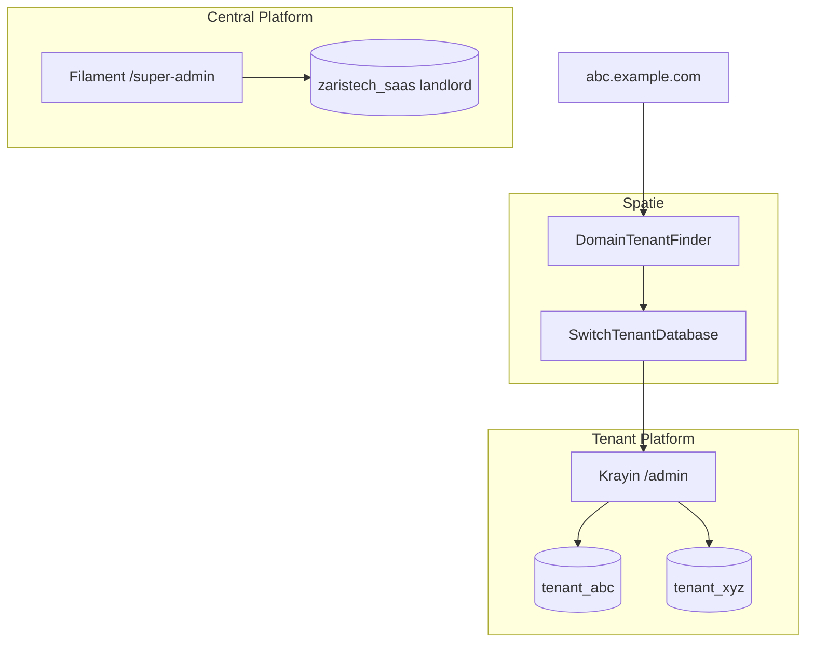
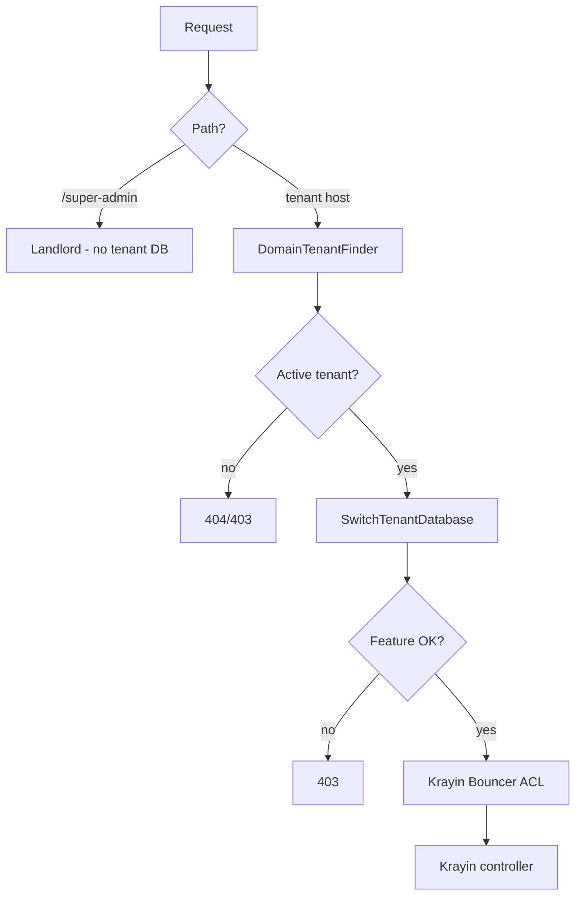

# CONTEXT7 MCP — OPTIONAL (never block)

## Context7 MCP (OPTIONAL — never block)

**Prefer** Context7 when it works. **Do not depend on it.**

If Context7 fails, is slow, or lacks the page you need:
1. Use official Laravel / Spatie / Filament docs and/or `vendor/` source.
2. Implement the work anyway.
3. Note the fallback briefly in `docs/SAAS_HANDOFF.md`.
4. **Never** set phase status to BLOCKED only because Context7 was unavailable.


# Krayin Multi-Tenant SaaS — Plan copy for OpenAI Codex

> **Identical playbook** shared with Copilot / Codex / Claude / Cursor.
> Canonical Cursor plan also lives at: `~/.cursor/plans/krayin_multi-tenant_saas_3c0b1cff.plan.md`
> Sibling copies: `PLAN_GITHUB_COPILOT.md` · `PLAN_OPENAI_CODEX.md` · `PLAN_CLAUDE.md`

## Paste this prompt when starting a new OpenAI Codex session

```text
Continue the Krayin multi-tenant SaaS project in /Users/ali/Desktop/krayin-saas-crm.

You are OpenAI Codex (CLI or Cloud).

Rules:
1. Read docs/SAAS_HANDOFF.md, docs/PROGRESS.md, docs/DECISIONS.md, docs/CHECKLIST.md first. Never trust chat history alone.
2. Also follow this plan file: docs/agents/PLAN_OPENAI_CODEX.md (same plan as Copilot/Claude copies).
3. Do not rebuild Krayin. Do not use Stancl. Do not use shared-DB tenant_id tenancy.
4. Follow the next incomplete phase in docs/PROGRESS.md only.
5. After work, update SAAS_HANDOFF.md + PROGRESS.md + CHANGELOG_SAAS.md.
6. Use MAMP MySQL 127.0.0.1:8889. Filament at /super-admin. Krayin at /admin.
7. Keep Krayin Bouncer/ACL for tenant permissions. No Spatie Permission in v1.
8. Stock Krayin modules only in v1 (no UnifiedInbox port yet).
9. If docs/ continuity files are missing, start at PHASE 0.
10. Context7 is OPTIONAL. If unavailable, use official docs + vendor/ and implement immediately — never block a phase for Context7.
11. Follow the Git branching and commit workflow in §0.5; never do project work directly on `main`.
12. IMPORTANT: Do not add a `Co-authored-by` trailer or assistant co-author attribution to commit messages unless the user explicitly requests it.
```

## Sync rule

If you change architecture decisions, update **all three** agent plan copies AND `docs/DECISIONS.md` + Cursor plan so they stay identical in substance.

---

# Krayin CRM Multi-Tenant SaaS — Agent Continuity Playbook

This plan is written so **any coding agent** (Cursor, GitHub Copilot, Claude, Codex, Windsurf, etc.) can continue after another agent stops — including when a Cursor limit/session ends.

**Golden rule for every agent:** Do NOT trust chat history. Trust only files in the repo.

---

## 0. How to continue (read this first — every new agent)

### 0.1 Startup ritual (mandatory)

Before writing any code, the agent MUST:

1. Open workspace: `/Users/ali/Desktop/krayin-saas-crm`
2. Read in order:
   - `docs/SAAS_HANDOFF.md` — current status, next phase, blockers
   - `docs/PROGRESS.md` — phase checklist with DONE/IN_PROGRESS/PENDING
   - `docs/DECISIONS.md` — locked architecture decisions (do not reopen without user ask)
   - `docs/CHECKLIST.md` — acceptance checks for the current phase
3. Run: `git status` and `git log -5 --oneline` (if git exists)
4. Start **exactly** at the first phase in `docs/PROGRESS.md` that is not `DONE`
5. After finishing a phase (or stopping mid-phase): **update the three docs** before ending the turn
6. Context7 optional; if missing use official docs + vendor/ and continue — never block

If `docs/` does not exist yet → you are at **PHASE 0**. Create the handoff docs first, then continue.

### 0.2 Stop / handoff ritual (mandatory when ending a session)

Before the agent stops (limit, user pause, or end of turn after meaningful work):

1. Update `docs/PROGRESS.md` — mark finished items DONE; leave current item IN_PROGRESS with notes
2. Update `docs/SAAS_HANDOFF.md` — fill the template:
   - Last completed phase
   - Exact next command / next file to touch
   - Blockers
   - Commands already run
   - Files created/modified this session
3. Append a dated entry to `docs/CHANGELOG_SAAS.md` (one short bullet list)
4. Do **not** leave half-applied migrations without noting them

### 0.3 Continuity files (source of truth)

| File | Purpose |
|------|---------|
| `docs/SAAS_HANDOFF.md` | **Next agent reads first** — where we are, what to do next |
| `docs/PROGRESS.md` | Phase-by-phase checkbox status |
| `docs/DECISIONS.md` | Locked decisions (never contradict silently) |
| `docs/CHECKLIST.md` | Per-phase acceptance criteria |
| `docs/CHANGELOG_SAAS.md` | Session-by-session what changed |
| `docs/ENV_NOTES.md` | MAMP ports, DB names, local URL patterns (no secrets) |

These files are created in **PHASE 0** and kept updated forever.

### 0.4 Prompt paste for any new agent (user can copy this)

```text
Continue the Krayin multi-tenant SaaS project in /Users/ali/Desktop/krayin-saas-crm.

Rules:
1. Read docs/SAAS_HANDOFF.md, docs/PROGRESS.md, docs/DECISIONS.md, docs/CHECKLIST.md first.
2. Do not rebuild Krayin. Do not use Stancl. Do not use shared-DB tenant_id tenancy.
3. Follow the next incomplete phase in docs/PROGRESS.md only.
4. After work, update SAAS_HANDOFF.md + PROGRESS.md + CHANGELOG_SAAS.md.
5. Use MAMP MySQL 127.0.0.1:8889. Filament at /super-admin. Krayin at /admin.
6. Keep Krayin Bouncer/ACL for tenant permissions. No Spatie Permission in v1.
7. Stock Krayin modules only in v1 (no UnifiedInbox port yet).
8. Use a phase/task branch and commit each coherent, verified milestone; follow the mandatory §0.5 Git workflow.
```

---

### 0.5 Git branching and commit workflow (mandatory)

Keep `main` as the stable integration branch; do not implement project work directly on it.

Use this branch hierarchy:

```text
main
├── phase/<NN>-<short-name>       # One long-lived branch per active phase
│   ├── feat/<NN>-<short-name>    # Optional, independently shippable feature work
│   └── fix/<NN>-<short-name>     # Optional, focused bug fixes
└── docs/<short-name>             # Documentation-only tasks not tied to a phase
```

Workflow:

1. Before editing, inspect `git status`, the current branch, and recent commits. Preserve existing work; never reset, discard, or stage unrelated changes.
2. For a phase, create `phase/<NN>-<short-name>` from `main` if it does not exist; otherwise resume that branch. Use two-digit phase numbers (for example, `phase/01-bootstrap-krayin`).
3. Do phase work on its phase branch. Create a `feat/` or `fix/` child branch only for independent work that benefits from isolation; base it on the phase branch and merge it back there after validation. Do not create unnecessary branches for every small change or session.
4. For standalone documentation work, use `docs/<short-name>` from `main`.
5. Commit each coherent, verified milestone on its task or phase branch using concise conventional messages, such as `feat(phase-02): add tenant database switch` or `docs: define git workflow`. Stage only the files belonging to that commit. Do not create empty commits or commit secrets.
6. Before ending, verify the branch and commit history, run the relevant checks, and update the handoff docs. Do not push, open a PR, or merge into `main` unless the user asks.
7. If existing staged or unstaged changes cannot safely be separated from the requested work, preserve them and ask before committing or switching branches.
8. **IMPORTANT — Commit attribution:** Never append a `Co-authored-by` trailer or assistant co-author attribution to a commit message. Include it only when the user explicitly asks for it.

---

## 1. Locked decisions (also mirror into docs/DECISIONS.md)

| ID | Decision |
|----|----------|
| D1 | Workspace: `/Users/ali/Desktop/krayin-saas-crm` (fresh start; was empty) |
| D2 | Base: official Krayin CRM **2.2** (`krayin/laravel-crm`) — user chose **1A** |
| D3 | Scope v1: stock Krayin + SaaS layer only — user chose **2A** |
| D4 | Tenancy: `spatie/laravel-multitenancy` + **one MySQL database per tenant** |
| D5 | Forbidden: Stancl; two tenancy frameworks; shared-DB `tenant_id` SaaS; copy of `Krayin_laravel_CRM_local` TenantManagement |
| D6 | DB: MAMP MySQL `127.0.0.1:8889`, user `root` |
| D7 | Landlord DB name: `zaristech_saas` |
| D8 | Tenant DB name pattern: `tenant_{slug}` |
| D9 | Filament Super Admin: `/super-admin` on landlord |
| D10 | Krayin CRM UI: `/admin` (or `APP_ADMIN_PATH`) on tenant DB |
| D11 | Tenant authz: keep Krayin **Bouncer/ACL** (no Spatie Permission in v1) |
| D12 | Features: custom tables `plans` / `plan_features` / `tenant_features` (not Pennant in v1) |
| D13 | Tenant override beats plan default |
| D14 | Never trust `tenant_id` from request; resolve tenant from domain only |
| D15 | Do not destroy unrelated projects; do not commit secrets |
| D16 | Context7 optional; never hard-block — use official docs/vendor and continue |

---

## 2. Target architecture (summary)



**Connections:**

- `landlord` → `zaristech_saas` (SaaS tables only)
- `tenant` → dynamic DB name from `tenants.database`
- Default connection: landlord for platform; switches to tenant when Spatie makes a tenant current

---

## 3. Baseline after PHASE 1 (official Krayin)

| Item | Value |
|------|--------|
| PHP | ^8.3 |
| Laravel | ^12 |
| Krayin | 2.2.x |
| Auth | Guard `user` → `Webkul\User\Models\User` |
| Permissions | Bouncer + `roles` JSON ACL |
| Packages | Activity, Admin, Attribute, Automation, Contact, Core, DataGrid, DataTransfer, Email, EmailTemplate, GoogleContact, Installer, Lead, Marketing, Product, Quote, Tag, User, Warehouse, WebForm |
| Not installed yet | Filament, Spatie Multitenancy, Pennant, Spatie Permission, UnifiedInbox |

---

## 4. Proposed repo layout (SaaS additions)

```
docs/
  SAAS_HANDOFF.md
  PROGRESS.md
  DECISIONS.md
  CHECKLIST.md
  CHANGELOG_SAAS.md
  ENV_NOTES.md
app/
  Models/Tenant.php, Domain.php, Plan.php, ...
  Services/TenantProvisioningService.php, TenantDatabaseManager.php, FeatureEntitlementService.php
  Http/Middleware/EnsureTenantFeature.php
  Filament/...
  Console/Commands/...
database/migrations/landlord/
config/multitenancy.php
config/features.php
storage/tenants/{slug}/
packages/Webkul/...   # stock Krayin — minimize edits
```

---

## 5. Landlord tables

`tenants`, `domains`, `plans`, `plan_features`, `tenant_features`, `subscriptions`, `platform_users`, `platform_settings`, optional `activity_log`.

Indexes: unique domain, unique tenant slug, unique tenant database name, composite feature keys.

No CRM business data on landlord.

---

## 6. Phases (executable units — one phase = one handoff unit)

Each phase has: **Goal · Steps · Done when · Docs to update**.

### PHASE 0 — Handoff docs (do first if missing)

**Goal:** Continuity system exists even before Krayin is installed.

**Steps:**

1. Create `docs/` with the six files listed in §0.3
2. Seed `PROGRESS.md` with all phases PENDING except PHASE 0
3. Copy locked decisions into `DECISIONS.md`
4. Put “NEXT: PHASE 1” in `SAAS_HANDOFF.md`

**Done when:** All six docs exist and `SAAS_HANDOFF.md` points to PHASE 1.

---

### PHASE 1 — Bootstrap official Krayin

**Goal:** Working stock Krayin in this folder on MAMP MySQL.

**Steps:**

1. Install Krayin 2.2 into `/Users/ali/Desktop/krayin-saas-crm` (composer create-project or git clone tagged 2.2)
2. Configure `.env`: `DB_HOST=127.0.0.1`, `DB_PORT=8889`, create a temporary single DB for install smoke test OR proceed to dual-connection in PHASE 2
3. `composer install`, `php artisan key:generate`, run stock install path enough to verify app boots
4. Document exact install commands in `CHANGELOG_SAAS.md` and `ENV_NOTES.md`

**Done when:**

- `artisan --version` works
- App boots without fatal errors
- `composer.json` shows `krayin/laravel-crm` / Laravel 12
- PROGRESS marks PHASE 1 DONE

**Next agent starts at:** PHASE 2

---

### PHASE 2 — Spatie Multitenancy foundation

**Goal:** Landlord + tenant connections; domain finder; DB switch task.

**Steps:**

1. `composer require spatie/laravel-multitenancy`
2. Publish config; set `landlord` / `tenant` connection names
3. Update `config/database.php` for MAMP :8889
4. Create `zaristech_saas` database
5. Domain-based tenant finder
6. `SwitchTenantDatabase` task registered
7. Smoke: manually set current tenant → query hits tenant DB

**Done when:** Config committed; landlord DB exists; documented smoke test passes; handoff updated.

**Next agent starts at:** PHASE 3

---

### PHASE 3 — Landlord schema + models

**Goal:** Central SaaS tables + Eloquent models on landlord connection.

**Steps:**

1. Migrations under `database/migrations/landlord/`
2. Models: Tenant, Domain, Plan, PlanFeature, TenantFeature, Subscription, PlatformUser, PlatformSetting
3. `php artisan migrate --database=landlord --path=database/migrations/landlord`
4. Seed a default Plan + feature keys in `config/features.php`

**Done when:** Migrations run clean; models use landlord connection; PROGRESS updated.

**Next agent starts at:** PHASE 4

---

### PHASE 4 — Tenant provisioning

**Goal:** One service creates DB + migrates + seeds + admin + rollback.

**Steps:**

1. `TenantDatabaseManager` (CREATE/DROP DATABASE)
2. `TenantProvisioningService` full flow + compensating rollback
3. Artisan: `tenants:migrate`, `tenants:seed` wrappers (Spatie `tenants:artisan` under the hood)
4. CLI path to provision one test tenant without Filament
5. Reserved domain validation

**Done when:** CLI can provision `tenant_demo` + login-capable admin on that DB; failure path cleans up; docs updated.

**Next agent starts at:** PHASE 5

---

### PHASE 5 — Filament Super Admin

**Goal:** `/super-admin` manages tenants/plans/features via the service.

**Steps:**

1. Install Filament; panel path `/super-admin`
2. Auth against `platform_users` (landlord)
3. Resources: Tenant, Domain, Plan, Subscription, Feature overrides
4. Create Tenant action calls `TenantProvisioningService` only
5. Block tenant CRM users from panel

**Done when:** Platform admin can create/suspend tenant from UI; no DB passwords shown; handoff updated.

**Next agent starts at:** PHASE 6

---

### PHASE 6 — Feature entitlements

**Goal:** Plan defaults + tenant overrides; middleware + menu hide + 403.

**Steps:**

1. `FeatureEntitlementService` (override > plan)
2. Middleware `tenant.feature:{key}`
3. Apply to selected stock module route groups
4. Filter `menu.admin` when feature off
5. Cache + invalidate on Filament toggle

**Done when:** Disabled feature → menu hidden + direct URL 403; tests or manual checklist in CHECKLIST.md; docs updated.

**Next agent starts at:** PHASE 7

---

### PHASE 7 — Storage + queues

**Goal:** Tenant file isolation + job tenant context.

**Steps:**

1. Disk rooted at `storage/tenants/{slug}`
2. Switch task / listener updates filesystem root
3. Spatie tenant-aware queue jobs
4. Document worker command in ENV_NOTES

**Done when:** Upload for tenant A not readable via tenant B path helpers; job runs in correct DB; docs updated.

**Next agent starts at:** PHASE 8

---

### PHASE 8 — Isolation tests + harden

**Goal:** Automated proof of isolation.

**Tests required:**

- Domain A → tenant A DB; Domain B → tenant B DB
- Feature off → 403
- Tenant user → cannot access `/super-admin`
- Queue job preserves tenant
- Cross-tenant data read fails

**Done when:** Pest suite green for above; `SAAS_HANDOFF.md` status = `V1_COMPLETE` (or list remaining known issues).

---

## 7. Middleware flow (reference)



---

## 8. Compatibility risks (do not ignore)

| Risk | Mitigation |
|------|------------|
| Installer assumes single DB | Run CRM migrate/seed only on `tenant` connection |
| Package models default connection | Ensure tenant is current before CRM requests |
| `/admin` vs Filament | Filament only on `/super-admin` |
| Dual permission systems | Keep Bouncer; no Spatie Permission v1 |
| Local subdomains | Document hosts file / `*.localhost` in ENV_NOTES |
| Migrate CRM onto landlord by mistake | Landlord path only under `migrations/landlord` |

---

## 9. Out of scope for v1 (do not start unless user asks)

- Port UnifiedInbox / WhatsApp / AI / HelpDesk from `Krayin_laravel_CRM_local`
- Spatie Permission replacing Bouncer
- Stripe billing
- Migrating existing `zaristech_hub_portal` data into a tenant DB
- Stancl Tenancy

---

## 10. PROGRESS.md template (create in PHASE 0)

```markdown
# PROGRESS — Krayin Multi-Tenant SaaS

Last updated: YYYY-MM-DD HH:MM TZ
Current phase: PHASE_X
Status: NOT_STARTED | IN_PROGRESS | BLOCKED | V1_COMPLETE

## Phases
- [ ] PHASE 0 — Handoff docs
- [ ] PHASE 1 — Bootstrap Krayin
- [ ] PHASE 2 — Spatie Multitenancy
- [ ] PHASE 3 — Landlord schema
- [ ] PHASE 4 — Provisioning service
- [ ] PHASE 5 — Filament /super-admin
- [ ] PHASE 6 — Feature entitlements
- [ ] PHASE 7 — Storage + queues
- [ ] PHASE 8 — Isolation tests

## Blockers
- (none)

## Next action (one sentence)
- Create docs/ and mark PHASE 0 done, then install Krayin 2.2
```

---

## 11. SAAS_HANDOFF.md template (create in PHASE 0)

```markdown
# SAAS HANDOFF — read me first

## Snapshot
- Date:
- Agent/tool last used:
- Current phase:
- Phase status:

## Last completed
- ...

## Next concrete step
1. ...
2. ...

## Commands already run
```bash
# paste exact commands
```

## Files touched this session
- ...

## Blockers / env notes
- MAMP MySQL must be running on 8889
- ...

## Do NOT
- Use Stancl
- Put CRM tables on landlord
- Replace Krayin Bouncer in v1
- Port UnifiedInbox in v1
```

---

## 12. Execution gate

**Coding must not start until the user explicitly confirms this plan** (e.g. “execute”, “go ahead”, “implement”).

On confirmation, the first agent action is **PHASE 0** (create `docs/*`), then **PHASE 1**.

Every later agent starts at §0.1 Startup ritual.
